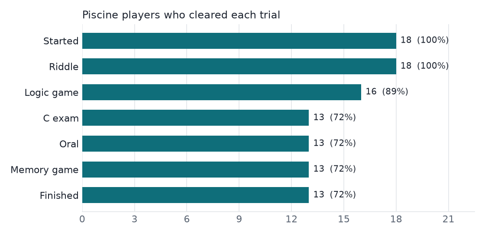

# Duck Hunt analytics

Data analysis of **Duck Hunt**, an escape game I built and ran for the October 2026
piscine at 42 Luxembourg (42 login, riddle, logic game, C exam, oral with a
lifeguard, memory game).

The game stores everything in SQLite. This project reads a copy of the production
database **read-only**, extracts it with SQL, computes metrics with pandas and
writes a short report with charts.

**[Read the report →](report/README.md)**



## What it answers

- How many piscine students started the hunt, and how many finished it?
- Which trial do players give up on?
- How long does each trial take?
- How did the public demo at the student fair go?

## How it works

| File | Role |
|---|---|
| `sql/players.sql` | One anonymised row per player (CTE + `ROW_NUMBER()`); filters out lifeguards and older students who tested the game |
| `sql/funnel.sql` | Players who got past each trial |
| `sql/stand.sql` | Runs and scores of the student-fair demo |
| `analyze.py` | Runs the queries, computes the metrics with pandas, draws the charts with matplotlib, writes `report/README.md` |

Who counts as a piscine player: accounts created by the intra for this piscine
(`intra_id >= 275000`, configurable with `--min-intra-id`), minus anyone who
validated an oral as a lifeguard.

## Run it

```sh
uv sync
uv run python analyze.py path/to/duck_hunt.db
```

## Privacy

The database is never committed (`.gitignore`). Logins are dropped inside the SQL
queries, and the report only contains aggregates.
