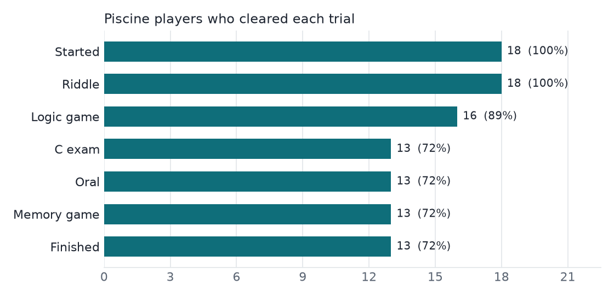
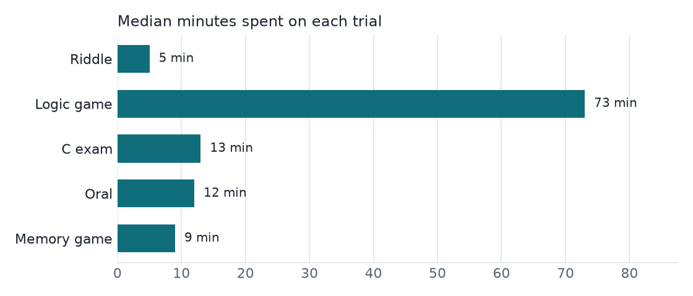

# Duck Hunt — what the data says

Escape game for the 42 Luxembourg piscine (October 2026). Data: production SQLite
database, read-only. Lifeguards and older students who tested the game are excluded;
players are anonymised in SQL (`sql/players.sql`).

## Key figures

- **18 piscine players** started the hunt; **13 finished it (72%)**.
- Biggest drop: **C exam**, where 3 players stopped.
- Riddle: 2.2 wrong answers on average before solving it (max 8).
- Finishers took a median of **2 h** from login to the last trial
  (fastest 1 h).

## Funnel

| trial       |   players |   % of starters |   lost at this step |
|:------------|----------:|----------------:|--------------------:|
| Started     |        18 |             100 |                   0 |
| Riddle      |        18 |             100 |                   0 |
| Logic game  |        16 |              89 |                   2 |
| C exam      |        13 |              72 |                   3 |
| Oral        |        13 |              72 |                   0 |
| Memory game |        13 |              72 |                   0 |
| Finished    |        13 |              72 |                   0 |

## Time per trial

Median minutes between clearing the previous step and clearing this one
(includes waiting for a lifeguard for the oral).

## Student fair demo

| game   |   runs |   finished_runs |   avg_score |   best_score |
|:-------|-------:|----------------:|------------:|-------------:|
| game   |      8 |               1 |         5   |            5 |
| memory |      5 |               5 |         1.2 |            3 |

## What I would change next piscine

- **C exam** is where players give up: add a hint or an easier first test there.
- The longest step is **Logic game** (73 min median): shorten it or split it.
